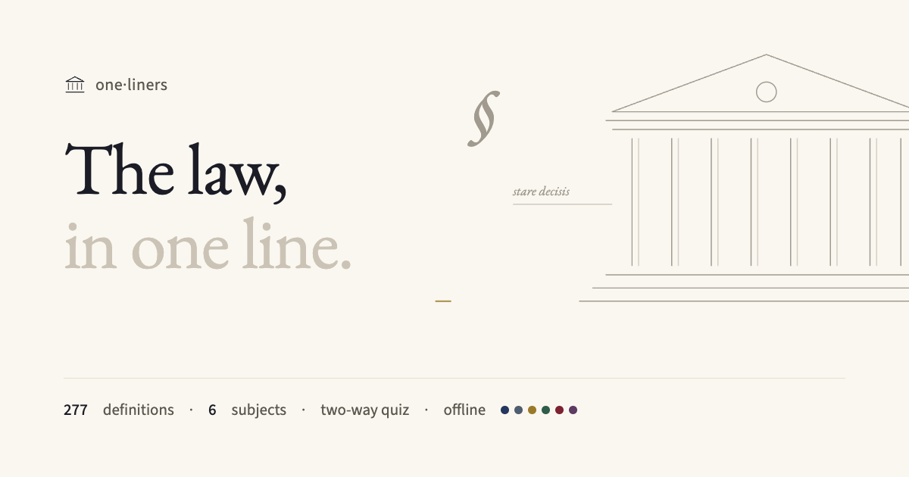
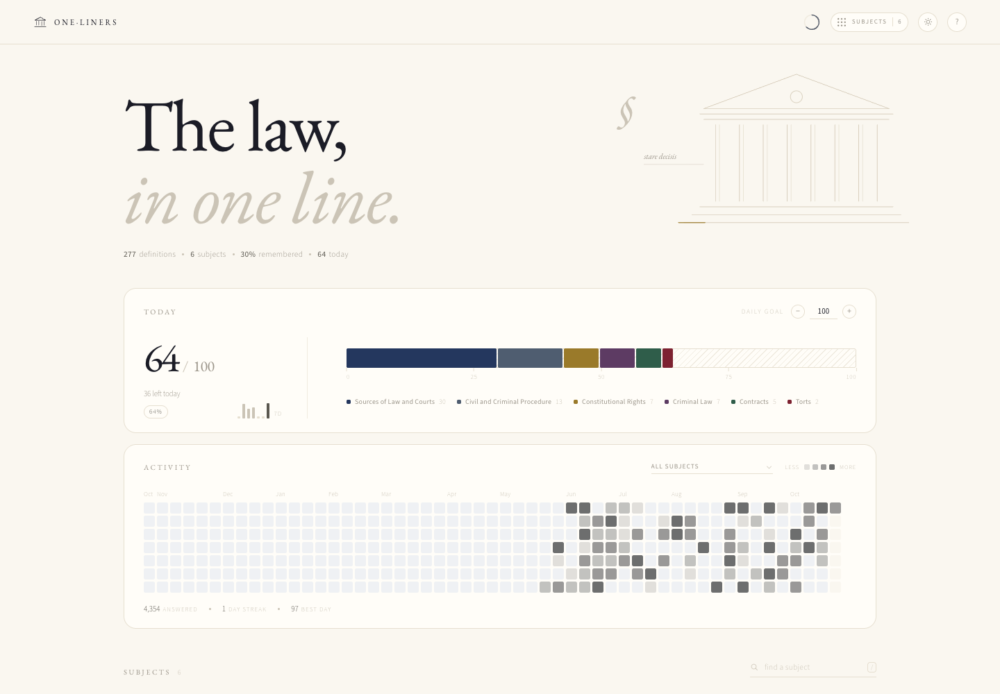
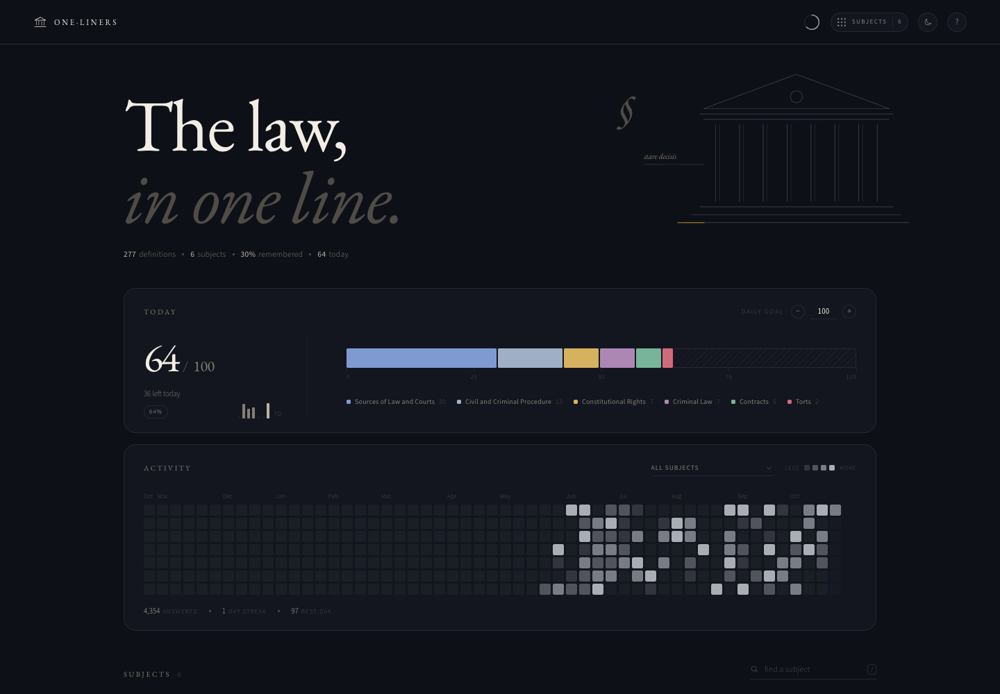
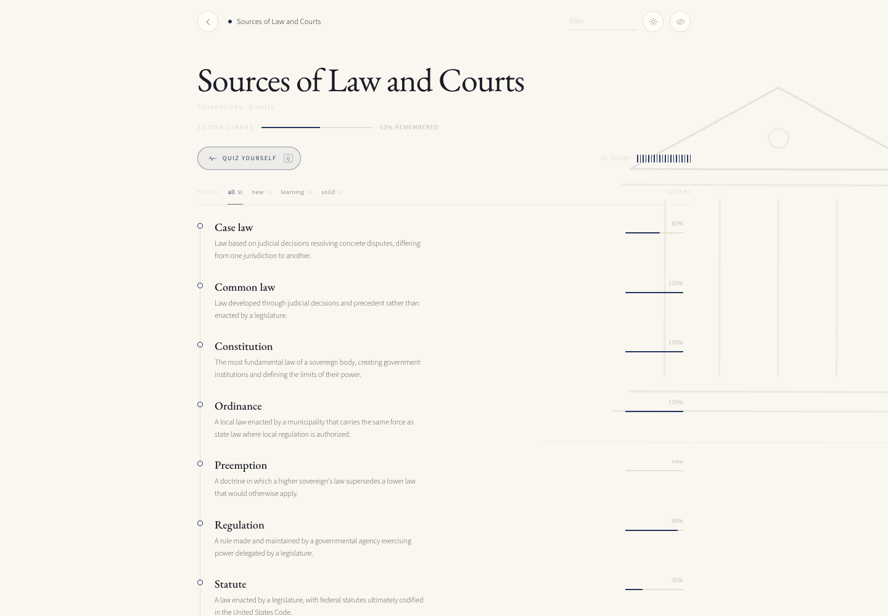
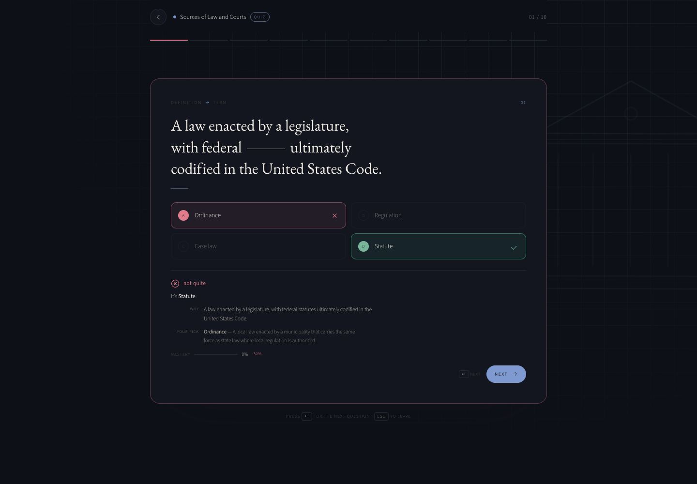
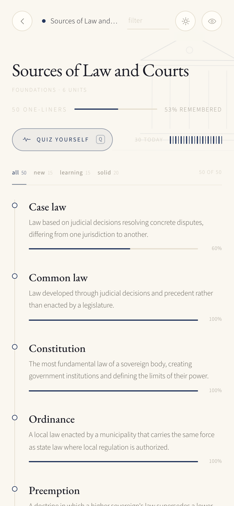

<div align="center">
  
</div>

<div align="center">

# one·liners · US Legal Literacy

**The law, in one line.**

A quiet legal dictionary you can practise: 277 definitions across 6 subjects — sources of law and the courts, civil and criminal procedure, constitutional rights, contracts, torts and criminal law — with an adaptive two-way quiz and a memory of what you actually know.

<a href="https://abhinav-prabhakar.github.io/LegalDefinitions/">
  
</a>

<br /><br />


</div>

<p align="center"><sub>Screenshots use sample study data. The app itself starts clean, on your device.</sub></p>

---

## Why this exists

Law is precise vocabulary with consequences. *Removal*, *firm offer*, *mala in se*, *judicial review* — each has an exact meaning that everyday English blurs. **one·liners** gives every term one careful line, quizzes it both ways, and keeps the near-synonyms honest.

Casebook cream, a Garamond with italic headings, navy ink and a gold rule under the courthouse steps. Each doctrine has its own colour. No accounts, no server, no noise.

> **Recognition is not recall.** Knowing *res judicata* when you read it is not the same as naming it from its effect. So the quiz asks both ways.

---

## Screenshots

<table>
  <tr>
    <td width="50%">
      
      <p align="center"><sub><strong>Light by default</strong> · today, activity, subject mastery</sub></p>
    </td>
    <td width="50%">
      
      <p align="center"><sub><strong>Dark when you choose it</strong> · remembered across visits</sub></p>
    </td>
  </tr>
</table>

<table>
  <tr>
    <td width="58%">
      
      <p align="center"><sub><strong>Every definition has a memory.</strong> Hover a row for its mastery and source.</sub></p>
    </td>
    <td width="42%">
      
      <p align="center"><sub><strong>Answers explain themselves.</strong> The definition, and what you picked.</sub></p>
    </td>
  </tr>
</table>

<div align="center">
  
  <p><sub><strong>320 → 1440px.</strong> The same quiet interface, not a crushed desktop.</sub></p>
</div>

---

## What's inside

**277 one-liners** across **6 subjects**, written for non-lawyers and first-year law students.

- **Foundations** — Sources of Law and Courts, Civil and Criminal Procedure, Constitutional Rights
- **Core doctrines** — Contracts, Torts, Criminal Law

| Subject | Definitions | Units |
| --- | ---: | --- |
| **Sources of Law and Courts** | 50 | Sources of law · Federal courts · State courts · Jurisdiction and venue · Precedent and stare decisis · Legal authority and citation |
| **Civil and Criminal Procedure** | 48 | Commencing a lawsuit · Pleadings and motions · Discovery · Trial and judgment · Appeals and finality · Criminal process stages |
| **Constitutional Rights** | 43 | Bill of Rights fundamentals · First Amendment freedoms · Due process · Equal protection · Search, seizure, and criminal process rights · Incorporation and state action |
| **Contracts** | 43 | Formation: offer and acceptance · Consideration and capacity · Defenses to formation · Performance and breach · Remedies |
| **Torts** | 45 | Negligence · Intentional torts · Strict liability and products liability · Damages · Defenses |
| **Criminal Law** | 48 | Elements and actus reus · Mens rea and culpability · Major offenses · Defenses · Punishment and sentencing |

Every definition is one sentence, 8–28 words, and carries a source locator. Hover a
definition's mastery rail to see where it came from. Coverage, gaps and assumptions are
documented in [`data/README.md`](data/README.md).

---

## Two directions of recall

Every round mixes both question types, balanced 5/5. You cannot coast on recognition.

| Prompt | You choose | What it trains |
| --- | --- | --- |
| `Judicial review` | one of four definitions | term → meaning |
| “A crime treated as inherently wrong under general community standards, such as murder.” | one of four terms | meaning → term |

- **The term is never in the question.** When a definition has to mention its own term, the
  quiz blanks it out, so meaning → term tests meaning.
- **Wrong answers that look right.** Distractors come from each definition's curated
  look-alikes, then from similar wording in the same unit — never four random strangers.
- **Adaptive sampling.** The three weakest definitions are guaranteed a slot; the rest are
  weighted toward low mastery.
- **Keyboard complete.** <kbd>1</kbd>–<kbd>4</kbd> or <kbd>A</kbd>–<kbd>D</kbd> to choose,
  <kbd>Enter</kbd> for next, <kbd>Esc</kbd> to leave, <kbd>r</kbd> to repeat a round.

---

## A memory you can see

Mastery is one confidence score per definition, stored locally: **+30%** for a correct answer,
**−40%** for a miss. Four clean answers reach 100%.

| After | Score | Reads as |
| --- | --- | --- |
| no attempts | 0% | `new` |
| 1 correct | 30% | `learning` |
| 2 correct | 60% | `familiar` |
| 3 correct | 90% | `solid` |
| a miss | −40% | re-learn |

The subject page shows a 2px bar on every definition; cards show a bar profile of the whole
subject; the home page has a daily goal stack and a quiet, monochrome activity trail.

---

## Offline, installable, private

- **Full PWA** — manifest, service worker, maskable icons. Works offline after the first load.
  Install from the browser's own menu (Chrome: the install icon in the address bar; iOS Safari:
  **Share → Add to Home Screen**; macOS Safari: **File → Add to Dock**).
- **No accounts, no analytics, no server.** Progress lives in `localStorage` under
  `oneliners.us-legal-literacy.*` and never leaves the device.
- **Self-hosted type** — EB Garamond, Source Sans 3. No external font requests.
- **Light by default**, dark when you choose it, remembered before first paint.

---

## Sources

| Source | Publisher | License |
| --- | --- | --- |
| [Bill of Rights transcript (Amendments I-X)](https://www.archives.gov/founding-docs/bill-of-rights-transcript) | U.S. National Archives | Public domain (US government work) |
| [Constitution Annotated: Analysis and Interpretation of the Constitution](https://constitution.congress.gov/) | Congressional Research Service, Library of Congress | Public domain (US government work) |
| [Justice 101: Steps in the Federal Criminal Process](https://www.justice.gov/usao/justice-101/steps-federal-criminal-process) | U.S. Department of Justice, Executive Office for U.S. Attorneys | Public domain (US government) |
| [Federal Rules of Civil Procedure](https://www.law.cornell.edu/rules/frcp) | Cornell Law School, Legal Information Institute (LII) | Public domain (US government law text); LII compilation CC BY-NC-SA 2.5 |
| [Federal Rules of Criminal Procedure](https://www.law.cornell.edu/rules/frcrmp) | Cornell Law School, Legal Information Institute (LII) | Public domain (US government law text); LII compilation CC BY-NC-SA 2.5 |
| [U.S. Constitution Annotated (LII edition)](https://www.law.cornell.edu/constitution-conan) | Cornell Law School, Legal Information Institute (LII) | CC BY-NC-SA 2.5 (LII edition of Congressional Research Service commentary) |
| [Business Law I Essentials 2e — Ch. 6 The Tort System](https://openstax.org/books/business-law-i-essentials-2e/pages/6-1-intentional-torts-and-negligence) | OpenStax (Rice University) | CC BY-NC-SA 4.0 |
| [Uniform Commercial Code, Article 2 — Sales](https://www.law.cornell.edu/ucc/2) | Cornell Law School, Legal Information Institute (LII) | CC BY-NC-SA 2.5 (LII edition) |
| [About Federal Courts](https://www.uscourts.gov/about-federal-courts) | Administrative Office of the U.S. Courts (US federal judiciary) | Public domain (US government work) |
| [Glossary of Federal Sentencing-Related Terms](https://www.ussc.gov/education/glossary) | United States Sentencing Commission | Public domain (US government) |
| [Wex: Legal Dictionary and Encyclopedia](https://www.law.cornell.edu/wex) | Cornell Law School, Legal Information Institute (LII) | CC BY-NC-SA 2.5 (LII original content, per LII site documentation) |

Definitions are paraphrased one-liners, not excerpts. Raw source material is not redistributed.

> [!IMPORTANT]
> Educational vocabulary only; not legal advice.

---

## Run it locally

```bash
# A server is required: the app fetches its data.
python3 -m http.server 8000
# → http://localhost:8000/
```

No build step, no dependencies. `index.html` is the whole app.

```text
.
├── index.html             # the entire app
├── manifest.webmanifest   # PWA manifest
├── sw.js                  # offline app shell + data cache
├── data/
│   ├── curriculum.json    # sections and subjects the app loads
│   ├── sources.json       # where every definition comes from
│   ├── collection.json    # scope, audience, assumptions
│   ├── README.md          # coverage report
│   └── subjects/*.json    # one file per subject
└── assets/                # icons, social card, screenshots, fonts
```

---

## The one·liners family

Same instrument, different vocabularies. Each has its own look, data and progress.

| Collection | Repository |
| --- | --- |
| [Electronics, in one line.](https://abhinav-prabhakar.github.io/ECEDefinitions/) | [`Abhinav-Prabhakar/ECEDefinitions`](https://github.com/Abhinav-Prabhakar/ECEDefinitions) |
| [Anatomy and physiology, in one line.](https://abhinav-prabhakar.github.io/AnatomyDefinitions/) | [`Abhinav-Prabhakar/AnatomyDefinitions`](https://github.com/Abhinav-Prabhakar/AnatomyDefinitions) |
| [Electricity, in one line.](https://abhinav-prabhakar.github.io/NECDefinitions/) | [`Abhinav-Prabhakar/NECDefinitions`](https://github.com/Abhinav-Prabhakar/NECDefinitions) |
| [HVAC, in one line.](https://abhinav-prabhakar.github.io/HVACDefinitions/) | [`Abhinav-Prabhakar/HVACDefinitions`](https://github.com/Abhinav-Prabhakar/HVACDefinitions) |
| [Medicine, in one line.](https://abhinav-prabhakar.github.io/MedicalDefinitions/) | [`Abhinav-Prabhakar/MedicalDefinitions`](https://github.com/Abhinav-Prabhakar/MedicalDefinitions) |
| [Nursing, in one line.](https://abhinav-prabhakar.github.io/NursingDefinitions/) | [`Abhinav-Prabhakar/NursingDefinitions`](https://github.com/Abhinav-Prabhakar/NursingDefinitions) |
| [Pharmacology, in one line.](https://abhinav-prabhakar.github.io/PharmacologyDefinitions/) | [`Abhinav-Prabhakar/PharmacologyDefinitions`](https://github.com/Abhinav-Prabhakar/PharmacologyDefinitions) |
| [Plumbing, in one line.](https://abhinav-prabhakar.github.io/PlumbingDefinitions/) | [`Abhinav-Prabhakar/PlumbingDefinitions`](https://github.com/Abhinav-Prabhakar/PlumbingDefinitions) |
| [Software, in one line.](https://abhinav-prabhakar.github.io/SoftwareDefinitions/) | [`Abhinav-Prabhakar/SoftwareDefinitions`](https://github.com/Abhinav-Prabhakar/SoftwareDefinitions) |
| **[The law, in one line.](https://abhinav-prabhakar.github.io/LegalDefinitions/)** | [`Abhinav-Prabhakar/LegalDefinitions`](https://github.com/Abhinav-Prabhakar/LegalDefinitions) |

### Credits

Definitions are paraphrased from public-domain and openly licensed legal references listed above. Built on the [one·liners](https://github.com/Abhinav-Prabhakar/ECEDefinitions) engine. Fonts: EB Garamond, Source Sans 3 (SIL Open Font License 1.1).

<div align="center">
  <sub>If this helps you read your first opinion, star the repo. It keeps the docket moving.</sub>
</div>
